# Pirate Game

A first-person co-op pirate game in a toon style, in the spirit of Sea of Thieves. Friends crew
one ship together on a shared sea hosted by a dedicated server. Built with Godot 4.7 (GDScript).

**Status: ten milestones built, the story under way.** Up to four crews of four players, each
with its own galleon: sailing, swimming, cannons, skeleton ships, holes, patching, bailing and
sinking; health, cutlass and pistol, skeleton camps and boarding; crew vs crew. Three trading
companies (the Gilded Hand, the Lantern Order and the Merrow Traders) offer treasure voyages,
bounties and cargo runs from a mission board, and the story, [the Ash Fleet](docs/specs/2026-10-08-story.md),
has begun: the prologue and Acts I to III are playable (twenty chapters, from the green lights
on Gull Isle to the siege of Port Merrow), with five side tales. Every pirate earns XP and levels (which never make anyone
stronger) and keeps their own gold, remembered by the server between sessions. The sea has a
24-minute day with sunsets, starry nights and lanterns, a storm that roams the map with big
waves, gusts and lightning that can hole your ship, and sound throughout. Specs:
[design](docs/specs/2026-10-07-pirate-game-design.md), [2](docs/specs/2026-10-07-m2-ship-combat.md),
[3](docs/specs/2026-10-07-m3-treasure.md), [4](docs/specs/2026-10-07-m4-fighting.md),
[5](docs/specs/2026-10-07-m5-crew-vs-crew.md), [art pass](docs/specs/2026-10-07-art-pass-1.md), [storm](docs/specs/2026-10-07-storm.md),
[Blender models](docs/specs/2026-10-07-art-pass-2-blender.md), [6 missions](docs/specs/2026-10-07-m6-missions.md),
[7 a pirate's life](docs/specs/2026-10-08-m7-pirates-life.md), [8 Act I](docs/specs/2026-10-08-m8-bones-in-the-sand.md), [9 Act II](docs/specs/2026-10-08-m9-the-ravens-due.md), [10 Act III](docs/specs/2026-10-08-m10-the-siege.md).

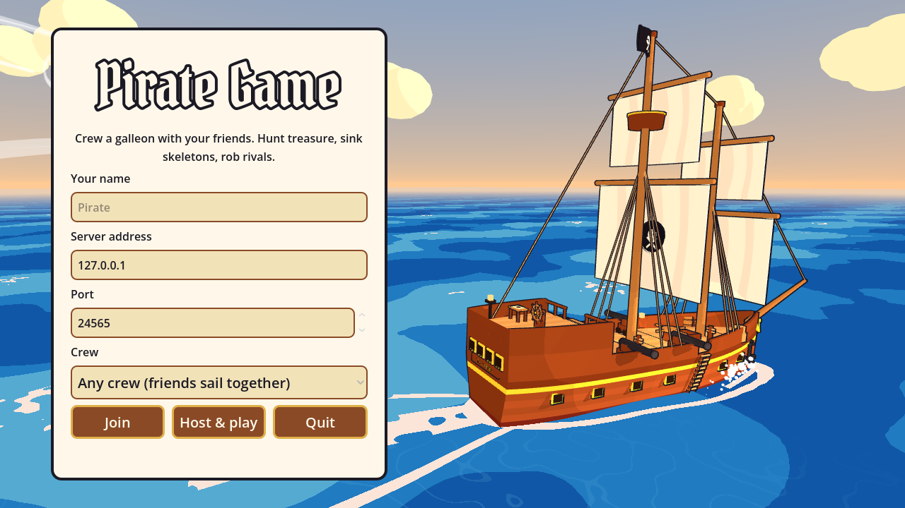

| | |
|---|---|
| 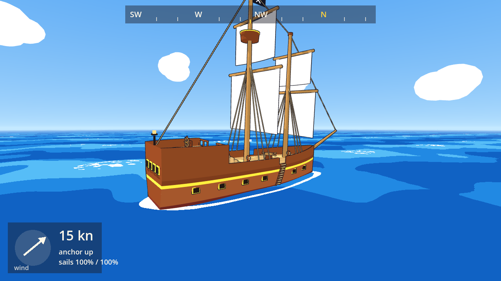 | 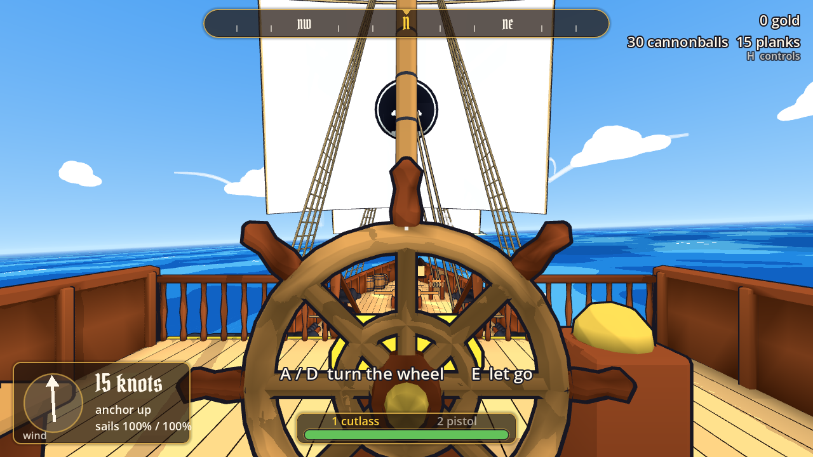 |
| 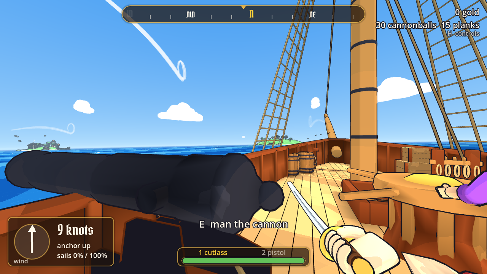 | 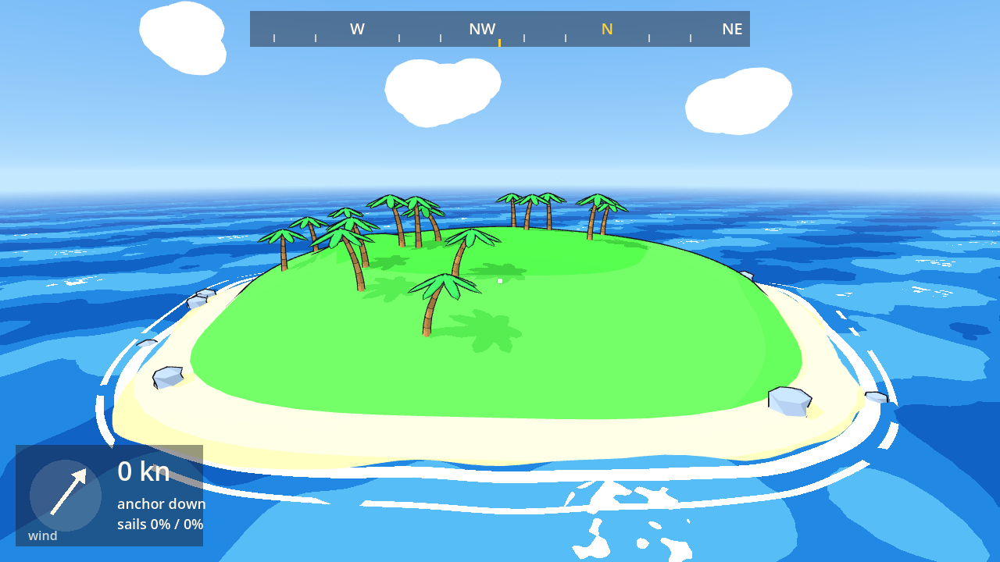 |
| 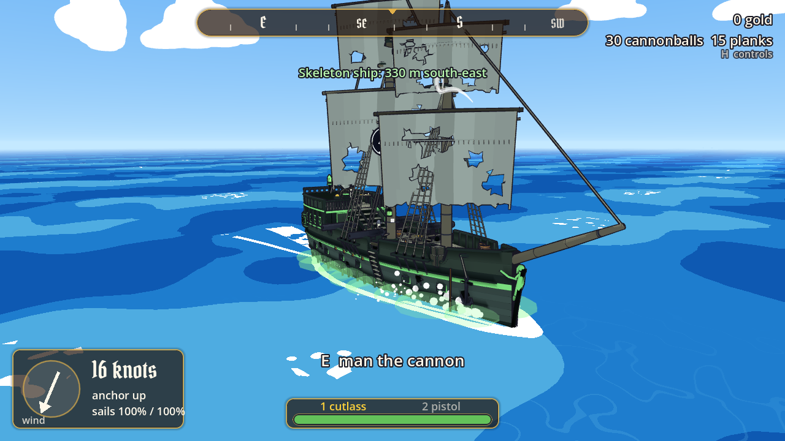 | 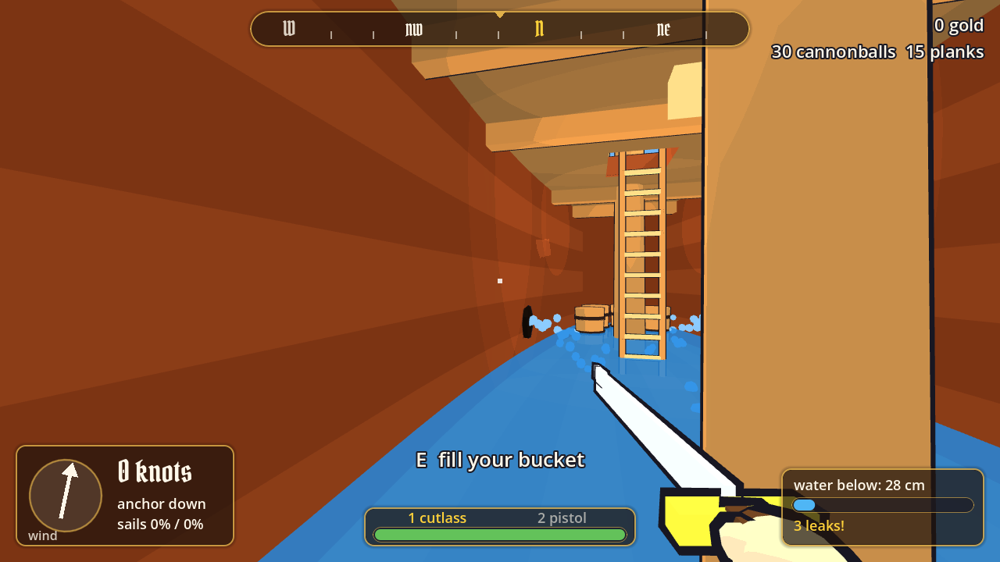 |
| 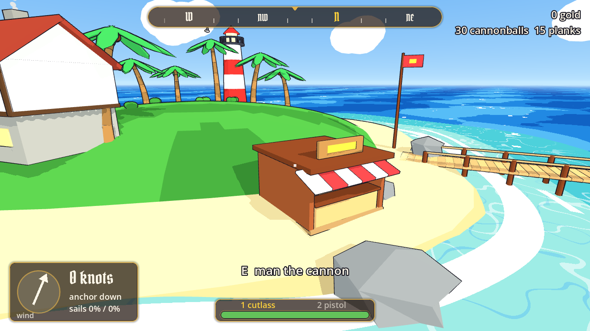 | 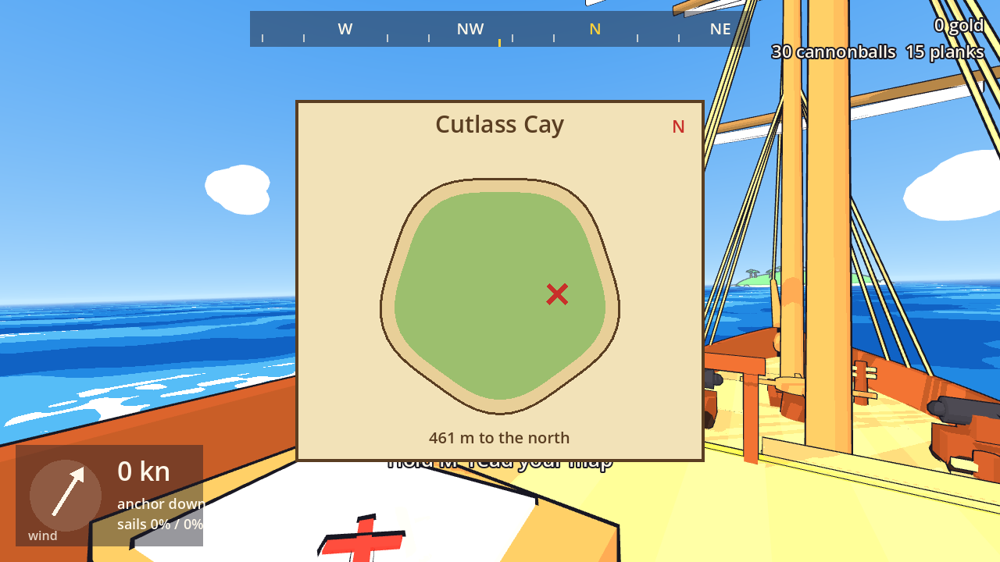 |
| 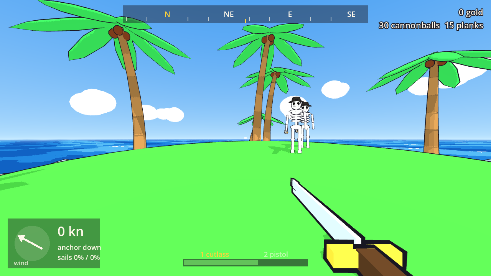 | 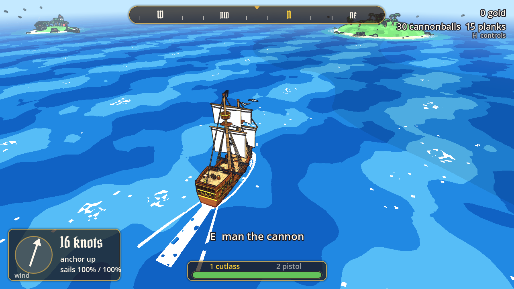 |
| 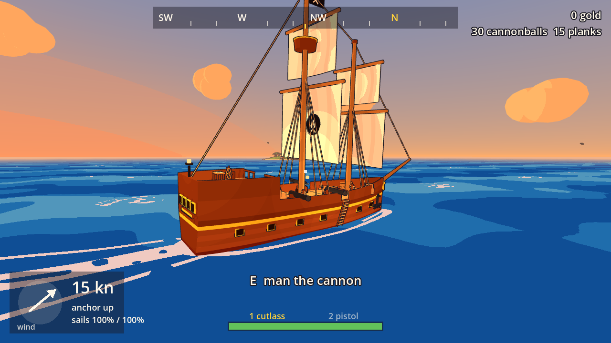 | 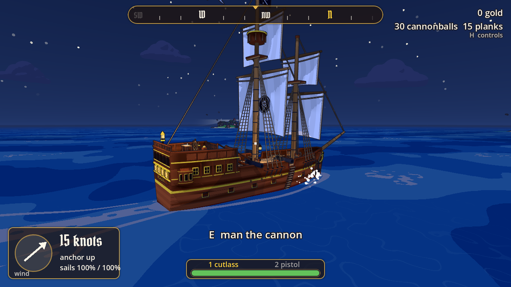 |
| 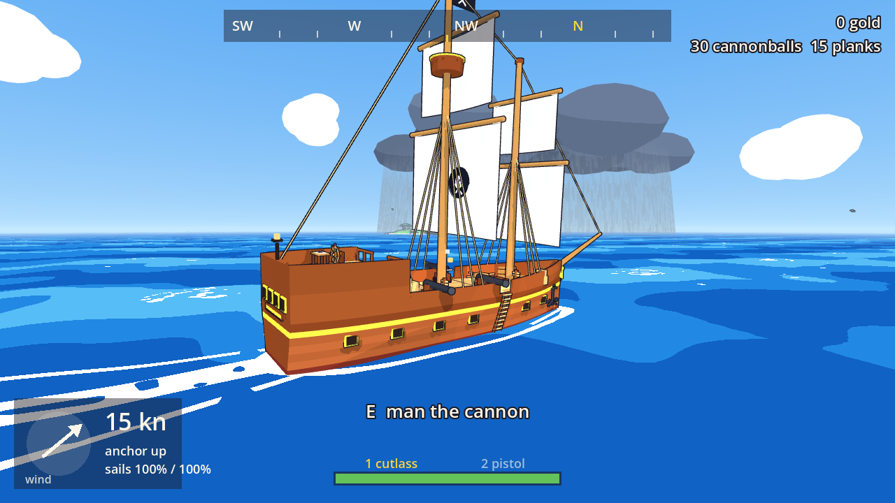 | 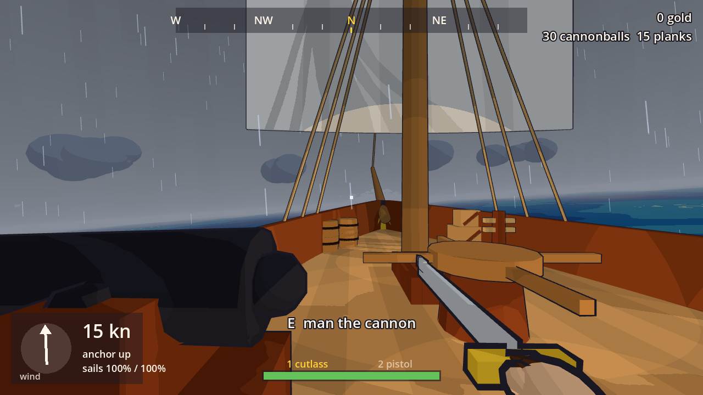 |
| 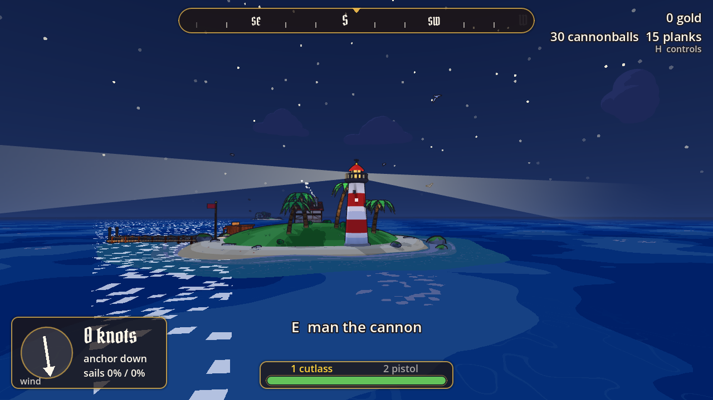 | 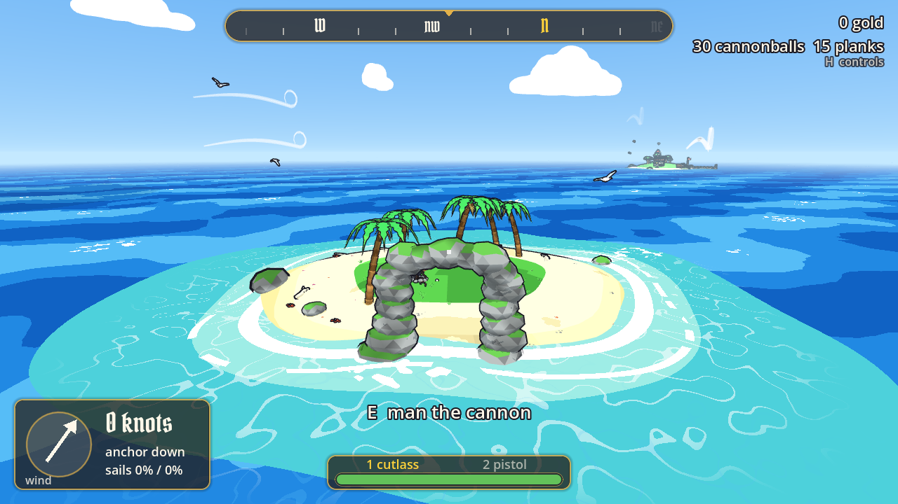 |
| 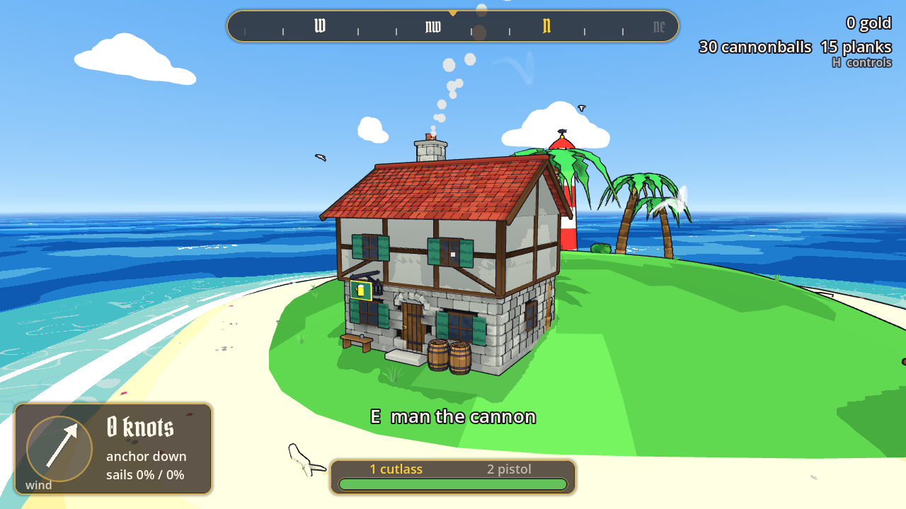 | |

## Play

**From a release** (Windows): download `PirateGame-windows-*.zip` from the repo's Releases, unzip,
run `PirateGame.exe`.

**From source**: install [Godot 4.7.2](https://godotengine.org/download/archive/4.7.2-stable/),
open this folder as a project and press Play (F5).

On the title screen:

- **Host & play** runs a server inside your game and puts you on deck. Good for trying it alone,
  or for friends on the same network to join you.
- **Join** connects to a server address (default port 24565).
- **Crew** picks which of the four crews to sail with. "Any crew" fills crew 1 first, so friends
  who all pick it end up on the same ship.

| Key | On foot | At the wheel | At the sail ropes | At the anchor |
|---|---|---|---|---|
| W / S | walk | | let sail out / take it in | hold W: winch up; S: drop |
| A / D | strafe | turn the wheel | swing the sails | |
| Mouse | look | look | look | look |
| E | use a station or ladder | let go | let go | let go |
| Shift / Space | run / jump | | | |
| Tab / Esc | crew list / menu | | | |

| Below decks and at the guns | |
|---|---|
| Cannon | E to man it, mouse to aim, left click to fire (3 s reload) |
| Hatch | E at the hatch in front of the main mast climbs down; E at the ladder foot climbs up |
| Patch a hole | look at it and hold E for 2 s |
| Bail | E in the water below fills your bucket; E on deck throws it overboard |
| Missions | E at the map table (beside the wheel): the mission board; 1-3 takes an offer; hold M to read the map |
| The story | at Port Merrow, E to talk to Moll the lighthouse keeper (and, later, Mother Wren); E reads journals |
| Green fires | E in the shallows fills your bucket; E at a green fire douses it (the dead climb out) |
| Dig | on an island, hold E for 2 s; at the X a chest comes up |
| Chests, skulls, crates | E picks up and puts down; chests sell to Silas at his stall, skulls to Mother Wren on the beach, crates go to the trader |
| Supplies | E at a supply barrel (Port Merrow's pier, or floating after a fight) refills the ship |
| Fight | 1 cutlass, 2 pistol, left click to attack; skeletons guard every treasure island |
| Board | swim to a skeleton ship and E at its ladder |
| Heal | E at the banana barrel on the lower deck |
| Other crews | their names show red; you can fight them, board their ship and steal its chests |

The ship starts at anchor with its sails furled. Winch the anchor up, let the sails out, and
watch the wind arrow at the bottom left: sails pull hardest with the wind behind them, and you
can swing them (A / D at the ropes) to catch a side wind.

## Run a server for friends

The same game runs as a dedicated server with no graphics:

```
PirateGame.exe --headless -- --server --port 24565        # Windows
./pirate-game-server.x86_64 --headless -- --server        # Linux (from a release)
```

Open UDP port 24565 and give friends your address. The server remembers every pirate (level,
gold, story) in `user://profiles/`, one file per name; `--profiles DIR` puts them elsewhere. For an always-on server on a small cloud
machine, see [server/README.md](server/README.md).

## Develop

| What | Command |
|---|---|
| Unit tests | `godot --headless --path . -s tests/run_tests.gd` |
| Bot smoke test (server + 4 bots) | `tests/smoke/smoke_test.sh` |
| Combat smoke test (fight + sinking) | `tests/smoke/combat_test.sh` |
| Treasure smoke test (dig + sell) | `tests/smoke/treasure_test.sh` |
| Fighting smoke test (island + boarding) | `tests/smoke/fighting_test.sh` |
| Crew-vs-crew smoke test (duel, broadsides, theft) | `tests/smoke/crew_test.sh` |
| Storm smoke test (lightning strikes a ship) | `tests/smoke/storm_test.sh` |
| Missions smoke test (bounty, skull, cargo) | `tests/smoke/missions_test.sh` |
| Story smoke test (prologue, thieves, saved pirates) | `tests/smoke/story_test.sh` |
| Act I smoke test (salt, powder kegs, diggers, bonfire) | `tests/smoke/act1_test.sh` |
| Act II smoke test (a bell, the dive, the fort's gate) | `tests/smoke/act2_test.sh` |
| Act III smoke test (the lighthouse, the battery, La Viuda) | `tests/smoke/act3_test.sh` |
| Every smoke test at once | `tools/smoke_all.sh` |
| Rebuild the sounds | `python3 tools/make_sounds.py` |
| Rebuild the models (needs Blender 5.2) | `tools/build_models.sh` (or `tools/build_models.sh ship` for one script) |
| Look at one model in the game's light | `tools/model_sheet.sh /tmp/pirate.png pirate --sheet-recolor 1` |
| Retake the README screenshots | `tools/readme_shots.sh` |
| Import and unit tests in one go | `tools/check.sh` |
| Screenshot without a monitor | `tools/screenshot.sh /tmp/shot.png outside --demo` |
| Export Windows + server builds | `tools/export.sh` |
| Release | push a tag like `v0.1.0`; CI builds both and publishes a GitHub release |

Run `godot --headless --path . --import` once after cloning so Godot registers the script classes.

Useful command-line options (after `--`): `--host`, `--join ADDRESS`, `--port N`, `--name NAME`,
`--demo` (host under full sail), `--bot wheel|sails|anchor|swimmer|gunner|repair`,
`--quit-after SECONDS`, `--no-ai`, `--ai-delay SECONDS`, `--test-holes N`, `--start-near N|outpost`,
`--voyage-island N`, `--test-chest`, `--test-boarding`, `--crew N`, `--crews-close`, `--test-steal`,
`--time T` (pin the time of day: 0 midnight, 0.5 noon, 0.79 sunset), `--storm X,Z` (pin the storm)
and `--calm` (server: no storm). Missions and story: `--mission treasure|bounty|cargo`, `--rep N`,
`--chapter ID` (`p1`, `p2`, `a1`..`a6`, `b1`..`b6`, tales `t1`..`t5`) with `--chapter-step N` and
`--chapter-aboard`, `--xp N`,
`--no-save`, `--profiles DIR`.
Bots also take `treasure`, `seller`, `fighter`, `boarder`, `duelist`, `thief`, `bounty`, `cargo`,
`courier`, `lights`, `moll`, `salter`, `kegs`, `bells` and `diver`.

### How it fits together

- `game/game.gd`: one session. The server half owns the ship and the crew list and sends
  snapshots 30 times a second; the client half draws everything 0.1 s in the past, blending
  snapshots, and runs your player.
- `game/net/net.gd`: the network transport (ENet over UDP) and every message.
- `game/ocean/waves.gd`: the one sea formula, shared by the server's ship physics and the sea shader.
- `game/ship/`: layout (`ship_shape.gd`), sailing maths (`ship_physics.gd`), the code-built model
  (`ship_mesh.gd`), and the still deck copy players walk on (`deck_proxy.gd`).
- `game/player/`: movement rules, your player, other players, test bots.
- `game/world/`: islands, the outpost, the time of day (`daylight.gd`) and the storm
  (`storm.gd` says where it is, `storm_view.gd` draws it). Both run off the shared server clock,
  so every player sees the same sunset and the same storm.
- `art/shaders/`: toon lighting, ink outlines, sky, rain.
- `art/sounds/`: every sound, synthesised by `tools/make_sounds.py` (numpy; nothing recorded or
  downloaded; the title tune is the traditional "Drunken Sailor"). `game/audio/audio.gd` (the
  `Audio` autoload) plays them: one-shots in the world, ambience loops that follow the scene,
  and music. Volume and music sliders are on the title screen.

- `art/blender/`: every model, as a Python script run by headless Blender 5.2
  (`tools/build_models.sh`), exported to `art/models/*.glb`. The exports are committed, so you
  only need Blender to change a model. `game/util/models.gd` loads them in the toon look.
  The sea, the sky and the island ground stay formulas in code, since the game plays on them.
